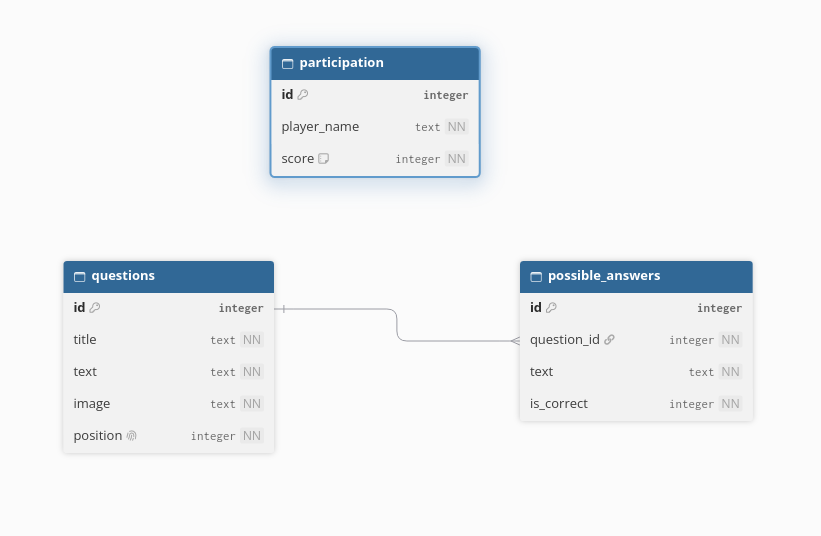

# Projet fullstack ESIEE Paris

Projet de developement d'un site web de A à Z 

# Partie API

API REST pour un quiz de culture générale. Le dépôt contient le back-end du projet : il permet de gérer les questions et leurs choix, d'enregistrer les participations, de calculer les scores et de consulter le classement. Une collection Postman fournit un quiz de démonstration de 20 questions.

**Technologies** — Python 3.13, Flask, SQLite, PyJWT, Flasgger et Postman.

## Démarrer en local

Prérequis : Python 3.13 avec `pip` et `venv`. Les commandes suivantes sont prévues pour Linux et macOS.

```bash
git clone https://github.com/LucasPokrywa/Projet-frontend.git
cd Projet-frontend/quiz-api
python3.13 -m venv venv
source venv/bin/activate
python -m pip install -r requirements.txt
```

Crée un fichier `quiz-api/.env` avec ces variables :

```dotenv
JWT_SECRET=remplacer-par-un-secret-local-aleatoire
JWT_DURATION=60
APP_ENV=dev
```

- `JWT_SECRET` sert à signer les JWT. Dans cette version, `POST /login` utilise aussi cette valeur comme mot de passe administrateur.
- `JWT_DURATION` définit la durée de validité du JWT en minutes.
- `APP_ENV=dev` active Swagger UI.

Le code actuel lit `JWT_SECRET`. Utilise ce nom dans ton fichier `.env`, même si le modèle `.env.example` contient `JWT_PASS` et `ADMIN_PASS`.

Depuis `quiz-api/`, lance le serveur :

```bash
python -m flask --app app run --debug
```

- [API locale](http://127.0.0.1:5000/)
- [Swagger UI](http://127.0.0.1:5000/apidocs/)

### Démarrer avec Docker

Depuis la racine d'un clone Git, construis l'image à partir des fichiers suivis du dossier `quiz-api/`, puis injecte la configuration locale au lancement :

```bash
git archive --format=tar HEAD:quiz-api | docker build -t quiz-api -
docker run --rm --env-file quiz-api/.env -p 127.0.0.1:5000:5000 quiz-api
```

Ces commandes utilisent une base interne au conteneur. Avec `--rm`, cette base est supprimée à l'arrêt du conteneur.

## Remplir et tester le quiz avec Postman

| Collection | Configuration | Utilisation |
| --- | --- | --- |
| `Quiz - 20 questions culture generale` | Renseigner les variables de collection `baseUrl` avec `http://127.0.0.1:5000` et `adminPassword` avec la valeur de `JWT_SECRET`. | Exécuter les dossiers dans l'ordre. La collection se connecte, réinitialise la base, ajoute 20 questions, enregistre deux participations de démonstration et vérifie le classement. |
| `Quiz TDD - Test` | Créer et sélectionner un environnement Postman avec `baseUrl` et `pwd`. Donner à `pwd` la valeur de `JWT_SECRET`. | Exécuter les dossiers de `0 - Rebuild DB` à `5 - Clean up` dans l'ordre. La connexion stocke automatiquement le JWT dans `access_token`. |

Les deux collections se trouvent dans [`quiz-api/postman/`](quiz-api/postman/). Elles exécutent des suppressions ou des réinitialisations. Utilise-les sur une base locale de démonstration ou de test.

Après avoir chargé les 20 questions, un appel à `GET /quiz-info` doit renvoyer le résultat suivant :

```json
{
  "size": 20,
  "scores": [
    { "playerName": "Alice", "score": 20 },
    { "playerName": "Bob", "score": 6 }
  ]
}
```

## Endpoints

| Méthode | Route | Action | Accès |
| --- | --- | --- | --- |
| `GET` | `/` | Vérifier que l'API répond | Public |
| `GET` | `/quiz-info` | Obtenir le nombre de questions et le classement | Public |
| `GET` | `/questions?position=1` | Lire une question et ses choix par position | Public |
| `GET` | `/questions/{id}` | Lire une question et ses choix par identifiant | Public |
| `POST` | `/participations` | Soumettre les réponses d'un joueur et enregistrer son score | Public |
| `POST` | `/login` | Obtenir un JWT avec un objet JSON contenant `password` | Mot de passe |
| `POST` | `/questions` | Ajouter une question et ses choix à une position donnée | JWT |
| `POST` | `/questions/{id}/answers` | Ajouter des choix à une question existante | JWT |
| `PUT` | `/questions/{id}` | Modifier une question, ses choix et sa position | JWT |
| `DELETE` | `/questions/{id}` | Supprimer une question et ses choix | JWT |
| `DELETE` | `/questions/all` | Supprimer toutes les questions et leurs choix | JWT |
| `DELETE` | `/participations/all` | Supprimer toutes les participations | JWT |
| `POST` | `/rebuild-db` | Vider et recréer les tables SQLite | JWT |

Pour les routes protégées, récupère le champ `token` renvoyé par `POST /login`, puis ajoute l'en-tête `Authorization: Bearer <token>`. Dans Swagger UI, clique sur **Authorize** et saisis aussi le préfixe `Bearer`.

Une participation contient `playerName` et `answers`. Le tableau `answers` contient un numéro de choix par question, dans l'ordre des positions du quiz. Les numéros de choix commencent à 1. Chaque bonne réponse rapporte un point.

## Base de données

Au premier démarrage, Flask crée le fichier SQLite `quiz-api/database` à partir de [`database.sql`](quiz-api/database.sql) s'il est absent. Les démarrages suivants réutilisent le fichier existant. Il est aussi possible de créer la base manuellement avec `python rebuild_db.py` depuis `quiz-api/`.

L'appel à `POST /rebuild-db` **efface les questions, les choix et les participations** avant de recréer les tables vides. Recharge ensuite les questions avec Postman.



## Structure du dépôt

| Fichier ou dossier | Rôle |
| --- | --- |
| `quiz-api/app.py` | Initialise Flask, Swagger et les dépôts SQLite |
| `quiz-api/routes.py` | Déclare les endpoints et valide les requêtes |
| `quiz-api/models/` | Regroupe les modèles et les opérations SQLite |
| `quiz-api/jwt_utils.py` | Génère et vérifie les JWT |
| `quiz-api/database.sql` | Définit les tables et leurs relations |
| `quiz-api/rebuild_db.py` | Initialise la base depuis la ligne de commande |
| `quiz-api/swagger.yml` | Configure la documentation Swagger |
| `quiz-api/postman/` | Contient les collections de démonstration et de tests |

## Licence

[GNU Affero General Public License v3.0](LICENSE).
